 

Desenvolvedor de Software <b>Full Stack</b>, graduando em <b>Engenharia de Software</b> e fundador da <b>GENS Web House</b> — unindo mais de 25 anos de vivência prática em infraestrutura e sistemas à engenharia moderna de aplicações web, APIs e Cloud.

<ul>
  <li>🎓 <b>Formação / Education:</b> Graduando em <b>Engenharia de Software</b> • 5 semestres de <b>Ciência da Computação</b> na <b>Universidade Estadual de Santa Cruz (UESC)</b> (2012).</li>
  <li>💻 <b>Infraestrutura &amp; Sistemas:</b> Experiência sólida desde <b>1999</b> na manutenção de computadores, laptops, redes e sistemas.</li>
  <li>👨‍🏫 <b>Docência:</b> Atuação por <b>5 anos</b> como <b>Professor de Programação em Delphi na Microlins</b>.</li>
  <li>🚀 <b>Foco Atual:</b> Desenvolvimento Full Stack e arquitetura de microsserviços com <b>Java, Spring Boot, Angular, TypeScript, PostgreSQL, MongoDB, Docker, Kubernetes, AWS e Azure</b>, aplicando metodologias ágeis e desenvolvimento assistido por IA (<b>Claude / Codex</b>).</li>
</ul>

  
<b>🇺🇸 Read in English</b>

   
  
<b>Full Stack Software Developer</b>, <b>Software Engineering</b> undergraduate, and founder of <b>GENS Web House</b> — combining over 25 years of hands-on systems and infrastructure background with modern web, API, and Cloud engineering.

  <ul>
    <li>🎓 <b>Education:</b> B.Sc. in <b>Software Engineering</b> (In Progress) • 5 semesters of <b>Computer Science</b> at <b>Universidade Estadual de Santa Cruz (UESC)</b> (2012).</li>
    <li>💻 <b>Infrastructure &amp; Systems:</b> Hands-on experience since <b>1999</b> in computer/laptop hardware maintenance, networking, and systems administration.</li>
    <li>👨‍🏫 <b>Teaching:</b> Worked for <b>5 years</b> as a <b>Delphi Programming Instructor at Microlins</b>.</li>
    <li>🚀 <b>Current Focus:</b> Full Stack development and microservices architecture with <b>Java, Spring Boot, Angular, TypeScript, PostgreSQL, MongoDB, Docker, Kubernetes, AWS, and Azure</b>, leveraging Agile practices and AI-assisted development (<b>Claude / Codex</b>).</li>
  </ul>

 

<h3>🌐 Connect</h3>

  
  
  
  

<h3>🛠️ Tech Stack</h3>

<b>Backend &amp; APIs</b>

  
  

<b>Cloud, DevOps &amp; Containers</b>

  
  
  
  

<b>Frontend</b>

  
  

<b>Databases</b>

  
  

<b>AI Engineering, Testing &amp; Agile</b>

  
  
  
  
  

<h3>🚀 Projetos em Destaque / Featured Projects</h3>

<table>
  <thead>
    <tr>
      <th align="left">Projeto</th>
      <th align="left">Descrição (PT / EN)</th>
      <th align="left">Stack</th>
    </tr>
  </thead>
  <tbody>
    <tr>
      <td><a href="https://github.com/georgiosampaio/fleetapi"><b>FleetAPI</b></a></td>
      <td><b>PT:</b> API de gestão de frotas com tratamento global de exceções e testes unitários. <b>EN:</b> Fleet management microservice with global exception handling and unit testing.</td>
      <td><code>Java</code> <code>Spring Boot</code> <code>JUnit 5</code> <code>Mockito</code></td>
    </tr>
    <tr>
      <td><a href="https://github.com/georgiosampaio/identity-api"><b>Identity API</b></a></td>
      <td><b>PT:</b> Serviço centralizado de autenticação, autorização e gerenciamento de usuários. <b>EN:</b> Centralized authentication, authorization, and user management microservice.</td>
      <td><code>Java</code> <code>Spring Boot</code> <code>PostgreSQL</code></td>
    </tr>
    <tr>
      <td><a href="https://github.com/georgiosampaio/agendador-tarefas"><b>Agendador de Tarefas</b></a></td>
      <td><b>PT:</b> Microsserviço de agendamento e gerenciamento de tarefas. <b>EN:</b> Task scheduling and management microservice.</td>
      <td><code>Java</code> <code>Spring Boot</code> <code>MongoDB</code></td>
    </tr>
    <tr>
      <td><a href="https://github.com/georgiosampaio/notificacao"><b>Notificação</b></a></td>
      <td><b>PT:</b> Serviço de mensageria e disparo de e-mails HTML dinâmicos. <b>EN:</b> Messaging microservice for dynamic HTML email notifications.</td>
      <td><code>Java</code> <code>Spring Boot</code> <code>Swagger</code> <code>Postman</code></td>
    </tr>
  </tbody>
</table>

<h3>📊 GitHub Stats</h3>

